# GeoFlow

**[Try the live demo](https://geoflow-2tsv.onrender.com)** (free server: the first visit can take about a
minute to wake it up, and maps take a minute or two)

**A node based app for making maps and doing spatial analysis.** You drag nodes onto a canvas and connect
them to fetch data, analyse it and produce a finished map, without needing GIS software. If you're new to
this, the **Make a map** assistant builds a ready made workflow for you, which you can then open up, change
and add to.

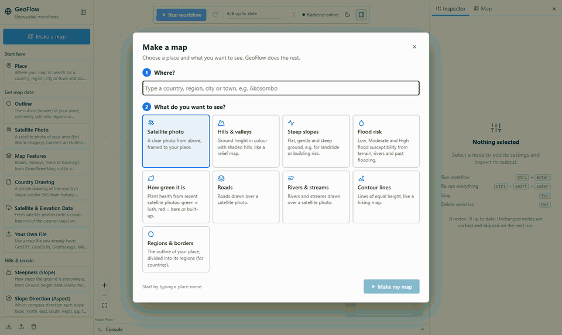

*Above: the **Make a map** assistant, a shortcut that builds a workflow from a template. Most of GeoFlow is
the node editor itself, where you connect nodes in any combination to build your own analysis
([see below](#build-your-own-workflow)).*

**United Kingdom**

| Flood susceptibility · York | Steep slopes · Lake District | Hills and valleys · Eryri (Snowdonia) |
|---|---|---|
| 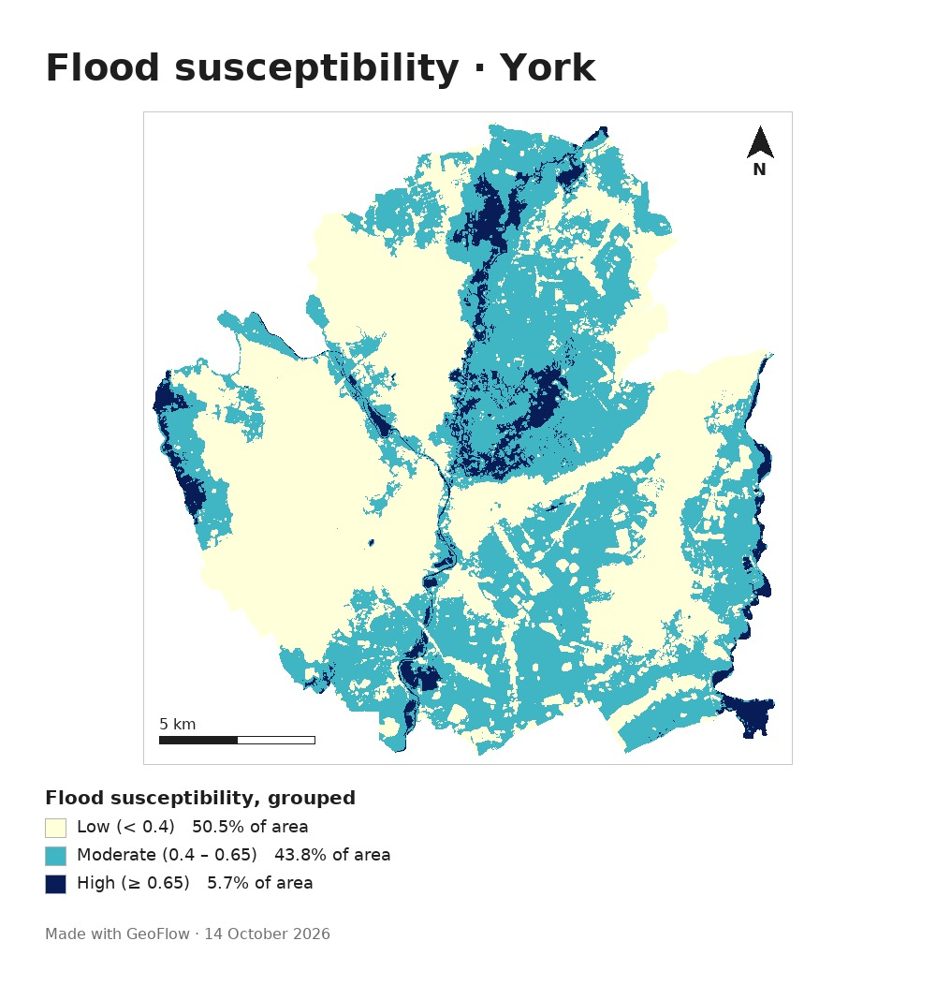 | 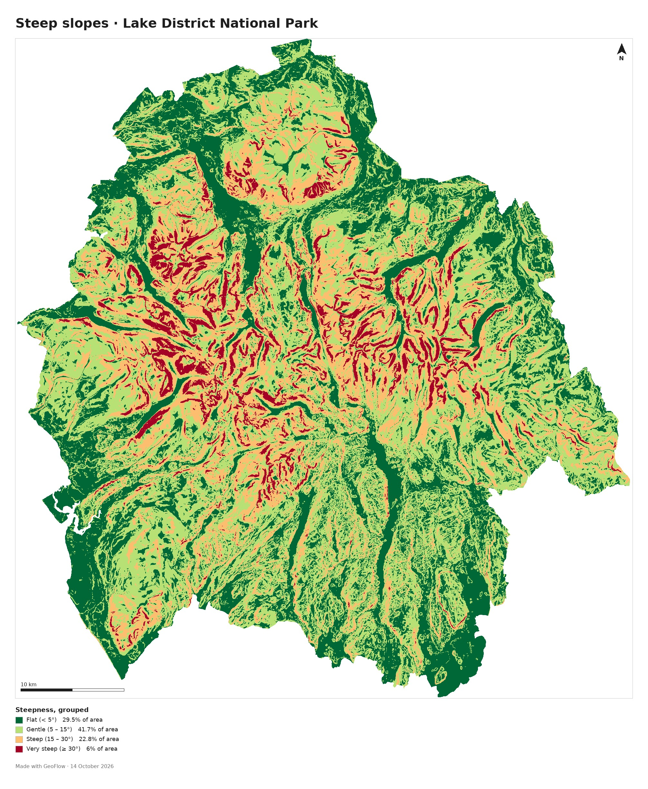 | 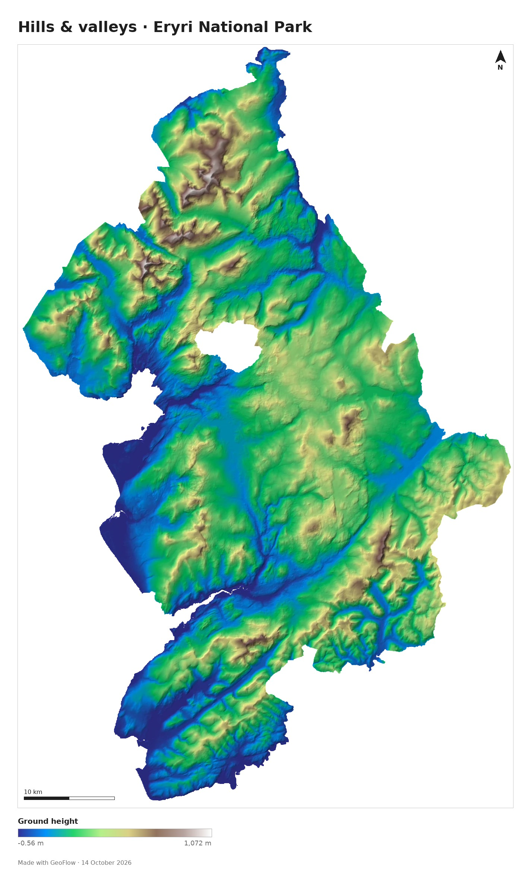 |

**Ghana**

| Flood susceptibility · Accra | Hills and valleys · Akosombo | Steep slopes · Akosombo |
|---|---|---|
| 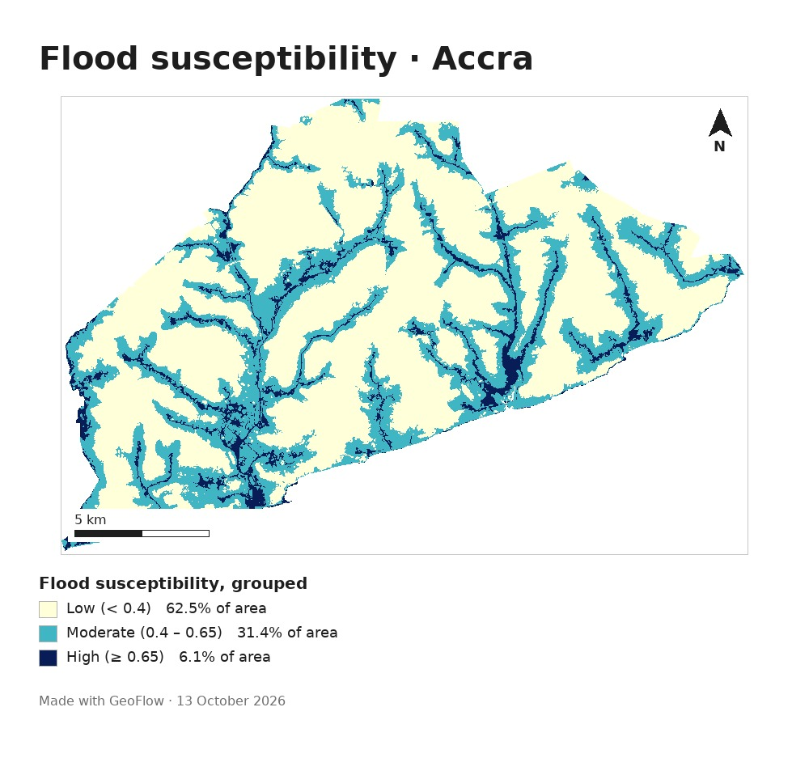 | 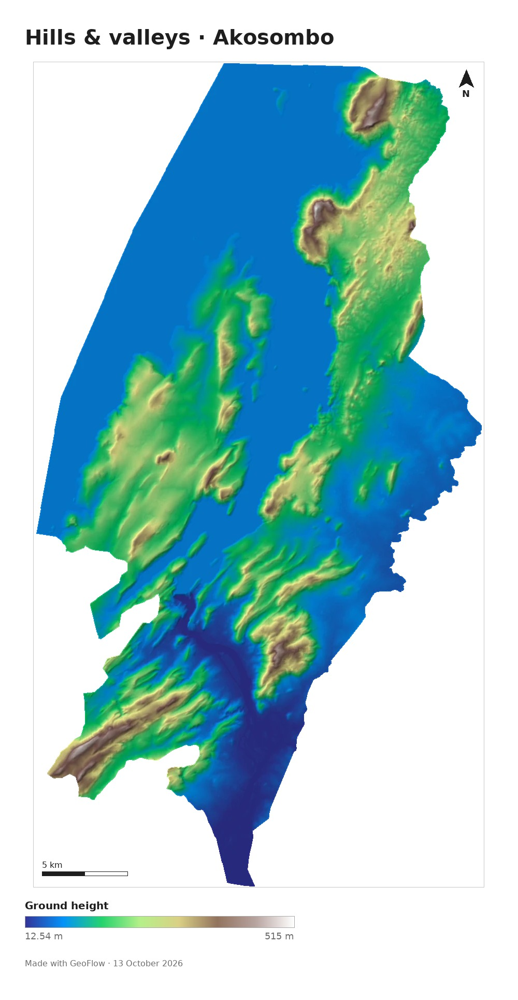 | 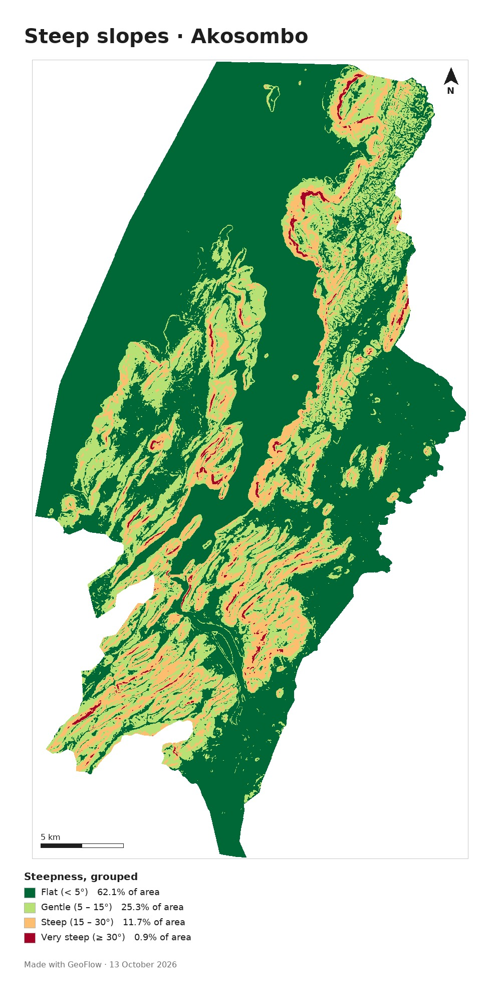 |

Each of these maps took a few clicks in the **Make a map** assistant, and the same workflows work anywhere
in the world.

## What it does

- **Node editor:** about 30 nodes you drag onto a canvas and connect however you like. Separate branches
  run at the same time, and steps that haven't changed aren't run again.
- **Make a map assistant:** search for a place, pick *Satellite photo, Hills and valleys, Steep slopes, Flood
  risk, How green it is, Roads, Rivers and streams, Contour lines* or *Regions and borders*, and you get a
  finished workflow you can edit.
- **Real data, downloaded as you need it:** official borders, Sentinel-2 and Landsat satellite photos, the
  Copernicus 30 m elevation model, JRC Global Surface Water (1984 to 2021) and OpenStreetMap.
- **Spatial analysis:** slope, aspect, ruggedness, hillshade, contours, Height Above Nearest Drainage (HAND),
  NDVI and other spectral indices, a raster calculator, reclassify, weighted overlay, zonal statistics,
  resampling, feature to raster, buffers, spatial filters, dissolve and distance.
- **Interactive map:** every result can be shown as a layer you can zoom into. Map tiles are drawn as you
  zoom, so results stay sharp. You can switch between a street map and satellite imagery underneath.
- **Export:** a JPEG ready to print, with a title, north arrow, scale bar and legend. Results can also be
  downloaded as GeoTIFF, GeoJSON or CSV.

### Build your own workflow

The templates are only a starting point. Every analysis is a chain of nodes you drag onto the canvas and
connect, and different combinations give different results. Here a workflow is built on an empty canvas
to map which way the slopes face across the Cairngorms. Then one node is swapped to map how rugged the
ground is instead. On the second run, the place, outline and elevation data are reused rather than
downloaded again.


### Easy to extend

Any map can be taken further. Here the Flood risk workflow gets roads added in under a minute: drag in a
**Map Features** node, connect it to the outline, and put it on top of the flood map with **Combine Layers**.
Only the new steps run.

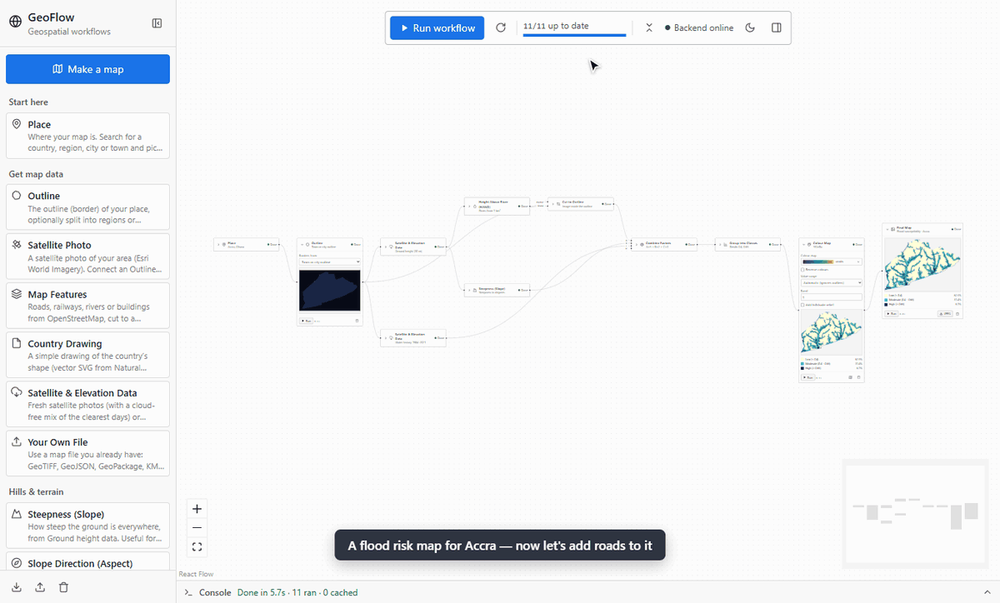

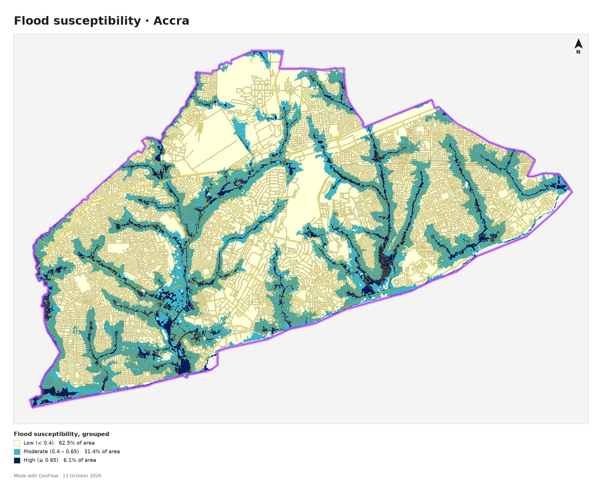

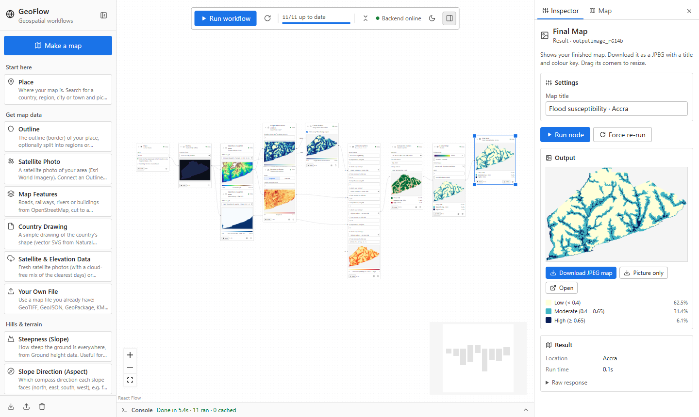

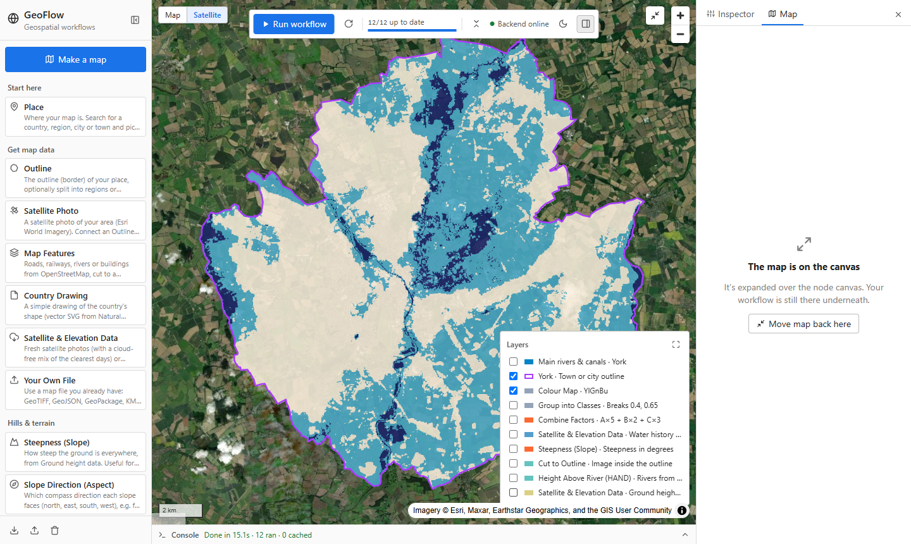

## How the flood analysis works

The **Flood risk** workflow screens for flood susceptibility from the terrain. It isn't an official flood
zone map, which needs detailed hydraulic modelling. It works in five steps:

1. **Height Above Nearest Drainage (HAND).** Hollows in the elevation model are filled so water can always
   flow downhill (priority flood filling, Barnes et al. 2014). Water is then routed to the steepest
   neighbouring cell (D8), and the height of every cell above the river it drains to is worked out. Land a
   few metres above its river floods first.
2. **Rivers.** Rivers and canals mapped in OpenStreetMap are cut into the elevation model, so that big rivers
   which collect their water outside the area still count. York's River Ouse, for example, drains about
   3,300 km² upstream, which an elevation model cut to the city can't see. Where the land has enough relief
   (like Accra), smaller streams traced from the terrain are added as well. In flat areas (like York, with
   less than 40 m between its lowest and highest ground), streams traced from 30 m data follow hedges and
   buildings rather than real channels, so only the mapped rivers are used.
3. **Slope.** Flat ground holds water. Slope is worked out with Horn's method, the same as ArcGIS and GDAL.
4. **Water history.** How often each 30 m cell has been seen underwater since 1984 (JRC Global Surface Water).
5. **Weighted overlay.** Each factor is scaled to a risk score from 0 to 1 and combined (height above river
   50%, water history 30%, slope 20%). The result is grouped into Low, Moderate and High.

In York, the High class picks out the River Foss corridor, the Ouse washlands and the Derwent Ings, while
the York moraine, the glacial ridge the city grew up on, comes out Low.

**Validation.** Compared with the Environment Agency's official Flood Zones, the workflow ranks flood zone
land above dry land with a ROC AUC of **0.92 in Sheffield** and **0.77 in York**, where 0.5 would be no
better than guessing. In Sheffield, three quarters of the High class is inside Flood Zones 2 or 3, which
cover only 5.5% of the city. Adding mapped rivers raised York's score from 0.62 to 0.77. See
[VALIDATION.md](VALIDATION.md) for the method, maps and limitations.

The same building blocks can be used for other analyses too, such as slope stability classes, plant health
from a cloud free Sentinel-2 composite, or averages per district with zonal statistics.

## Tech stack

- **Frontend:** React 19, Vite, React Flow (`@xyflow/react`), and MapLibre GL through `react-map-gl`
  ([`geoflow-project/`](geoflow-project/))
- **Backend:** Python, FastAPI, GeoPandas, Rasterio and GDAL, NumPy and SciPy, OSMnx, Matplotlib and Pillow
  ([`geoflow-backend/`](geoflow-backend/))
- **Data access:** STAC searches on Microsoft Planetary Computer, reading only the parts of Cloud Optimised
  GeoTIFFs that are needed. OpenStreetMap data comes from several Overpass servers at once, with the first
  answer used. Places are found with Nominatim.

## Run it locally

You'll need Python 3.11 or newer and Node.js 20.19 or newer.

```bash
# Backend (from geoflow-backend/)
python -m venv .venv
.venv\Scripts\python.exe -m pip install -r requirements.txt      # Windows
.venv/bin/pip install -r requirements.txt                         # macOS or Linux
.venv\Scripts\python.exe -m uvicorn main:app --reload             # http://localhost:8000

# Frontend (from geoflow-project/)
npm install
npm run dev                                                       # http://localhost:5173
```

On Windows you can double click `start-geoflow.cmd` instead, once both are installed.
See [`geoflow-project/README.md`](geoflow-project/README.md) for a list of every node.

### Run it with Docker

The [`Dockerfile`](Dockerfile) builds a single container in which the backend also serves the app:

```bash
docker build -t geoflow .
docker run -p 7860:7860 -e GEOFLOW_BASE_URL=http://localhost:7860 geoflow   # http://localhost:7860
```

The container switches on some limits meant for a public server: uploads of up to 50 MB, no more than 3
heavy steps at once, and results deleted after 6 hours. You can change these with `GEOFLOW_MAX_UPLOAD_MB`,
`GEOFLOW_MAX_JOBS` and `GEOFLOW_RETENTION_HOURS`, or set them to `0` to turn them off. Setting
`GEOFLOW_LOW_MEMORY=1` processes large areas at lower detail, so maps fit in about 400 MB of memory.

The public demo runs on Render's free plan and is set up by [`render.yaml`](render.yaml). To make your own,
choose **New**, then **Blueprint** on render.com and pick this repository.

## Data sources and limitations

GeoFlow uses data from geoBoundaries, GADM, OpenStreetMap (Nominatim and Overpass), Esri World Imagery,
Microsoft Planetary Computer (Sentinel-2, Landsat, Copernicus DEM and JRC Global Surface Water) and Natural
Earth. Please respect each provider's terms and credit them. The public OpenStreetMap services aren't meant
for heavy automated use.

The terrain analyses use the 30 m Copernicus elevation model, so anything narrower than about 30 m, like
urban drains or embankments, doesn't show up. Flood results are a screening for planning and setting
priorities, not official flood zones.

## Project status

GeoFlow is an active work in progress. The aim is to show what spatial analysis can look like for
people who need simple answers, like where floods are likely or how steep the ground is, but don't
have the time to learn a full GIS package such as ArcGIS. The analyses are deliberately kept simple
and are meant for exploration and screening, not professional or regulatory decisions.

Planned next steps:
- ~~Validate flood susceptibility against official flood maps~~ Done for York and Sheffield
  ([VALIDATION.md](VALIDATION.md)). Next: more sites, and test giving height above river more weight
- Support more detailed elevation data where it's available, such as UK LiDAR
- ~~Deploy a public demo~~ Done: [geoflow-2tsv.onrender.com](https://geoflow-2tsv.onrender.com)

## License

[MIT](LICENSE)
