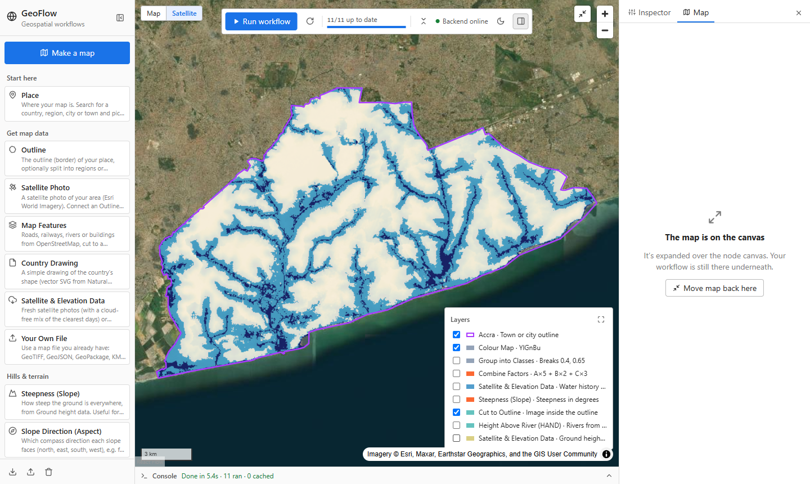

# GeoFlow

**A node-based geospatial workflow app.** Pick a place and what you want to see, and GeoFlow fetches the
data, runs the analysis and produces a finished map: no GIS software or expertise needed. Under the hood every
map is an editable workflow of nodes, so GIS users can open it up, tune it and build their own.


| Flood susceptibility · Accra | Hills & valleys · Akosombo | Steep slopes · Akosombo |
|---|---|---|
|  |  |  |

## What it does

- **Make a map assistant:** search a place, choose *Satellite photo, Hills & valleys, Steep slopes, Flood risk,
  How green it is, Roads, Rivers & streams, Contour lines* or *Regions & borders*, and get a finished map.
- **Visual workflow editor:** about 30 nodes you connect on a canvas, with independent branches run in parallel
  and unchanged steps cached.
- **Real data, fetched live:** administrative boundaries, Sentinel-2 / Landsat imagery, the Copernicus 30 m DEM,
  JRC Global Surface Water (1984–2021) and OpenStreetMap features.
- **Spatial analysis:** slope, aspect, ruggedness, hillshade, contours, Height Above Nearest Drainage (HAND),
  NDVI and other spectral indices, a raster calculator, reclassification, weighted overlay, zonal statistics,
  resampling and rasterization, buffers, spatial filters, dissolve and distance analysis.
- **Interactive map:** every result as a zoomable layer (rendered as tiles on demand, sharp at any zoom),
  with Map/Satellite basemaps.
- **Export:** a print-ready JPEG with title, north arrow, scale bar and colour key, plus GeoTIFF, GeoJSON and CSV downloads.

### Modular by design

Every map is a workflow you can extend. Here the Flood risk workflow gets a roads overlay in under a minute:
drag in a **Map Features** node, connect it to the outline, and stack it on the flood map with **Combine Layers**.
Only the new steps run; everything else comes from cache.




## How the flood analysis works

The **Flood risk** workflow is a terrain-based susceptibility screening (not a regulatory flood zone
determination, which requires hydraulic modelling):

1. **Height Above Nearest Drainage (HAND).** The DEM is conditioned with priority-flood depression filling
   (Barnes et al. 2014), flow is routed with D8, flow accumulation defines the river network, and every cell's
   height above the river it drains to is computed. Cells a few metres above their river flood first.
2. **Slope.** Flat ground holds water (Horn's method, as in ArcGIS/GDAL).
3. **Water history.** How often each 30 m cell was observed underwater since 1984 (JRC Global Surface Water).
4. **Weighted overlay.** Each factor is rescaled to 0–1 risk and combined (HAND 50%, water history 30%,
   slope 20%), then classed into Low / Moderate / High.

The same building blocks support other analyses, for example slope-stability classes, vegetation health from a
cloud-free Sentinel-2 median composite, or district-level summaries with zonal statistics.

## Tech stack

- **Frontend:** React 19, Vite, React Flow (`@xyflow/react`), MapLibre GL via `react-map-gl`
  ([`geoflow-project/`](geoflow-project/))
- **Backend:** Python, FastAPI, GeoPandas, Rasterio/GDAL, NumPy/SciPy, OSMnx, Matplotlib, Pillow
  ([`geoflow-backend/`](geoflow-backend/))
- **Data access:** STAC search on Microsoft Planetary Computer, reading only the needed parts of Cloud Optimized
  GeoTIFFs; Overpass with mirror fail-over; Nominatim geocoding.

## Run it locally

Requirements: Python 3.11+ and Node.js 20.19+.

```bash
# Backend (from geoflow-backend/)
python -m venv .venv
.venv\Scripts\python.exe -m pip install -r requirements.txt      # Windows
#   source .venv/bin/activate && pip install -r requirements.txt   (macOS/Linux)
.venv\Scripts\python.exe -m uvicorn main:app --reload             # http://localhost:8000

# Frontend (from geoflow-project/)
npm install
npm run dev                                                       # http://localhost:5173
```

On Windows you can instead double-click `start-geoflow.cmd` once both are installed.
See [`geoflow-project/README.md`](geoflow-project/README.md) for the full node reference.

## Data sources and limitations

geoBoundaries, GADM, OpenStreetMap (Nominatim, Overpass), Esri World Imagery, Microsoft Planetary Computer
(Sentinel-2, Landsat, Copernicus DEM, JRC Global Surface Water) and Natural Earth. Please respect each provider's
terms and attribution; the public OpenStreetMap services are not meant for heavy automated use.

Terrain analyses use the 30 m Copernicus DEM, so features narrower than about 30 m (urban drains, embankments)
are not resolved. Flood results are susceptibility screening for planning and prioritisation, not flood zone
designations.

## License

[MIT](LICENSE)
