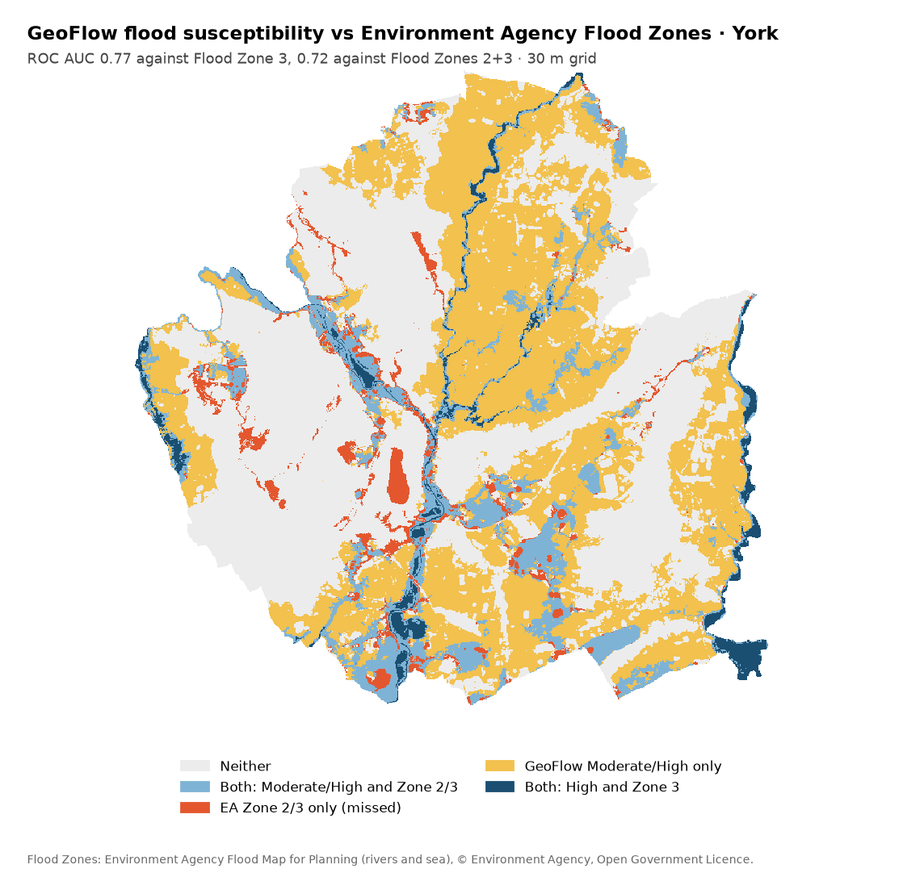
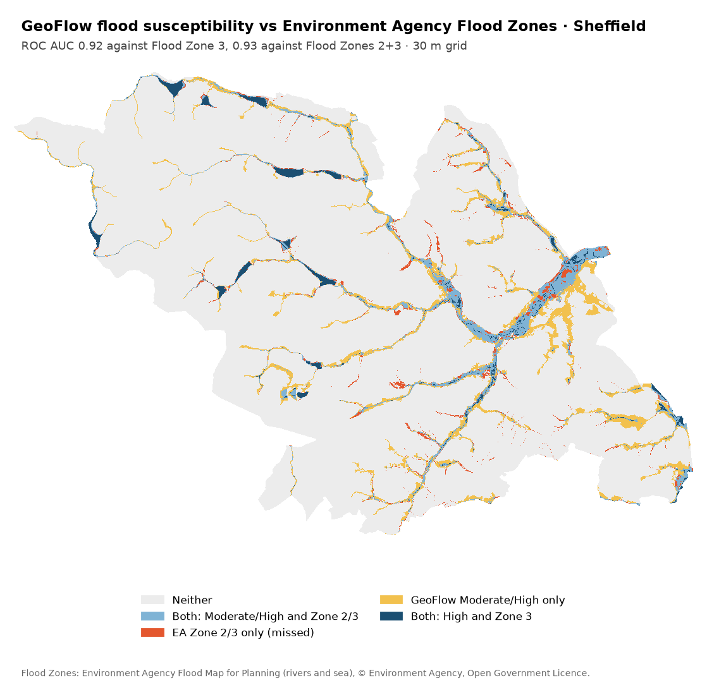
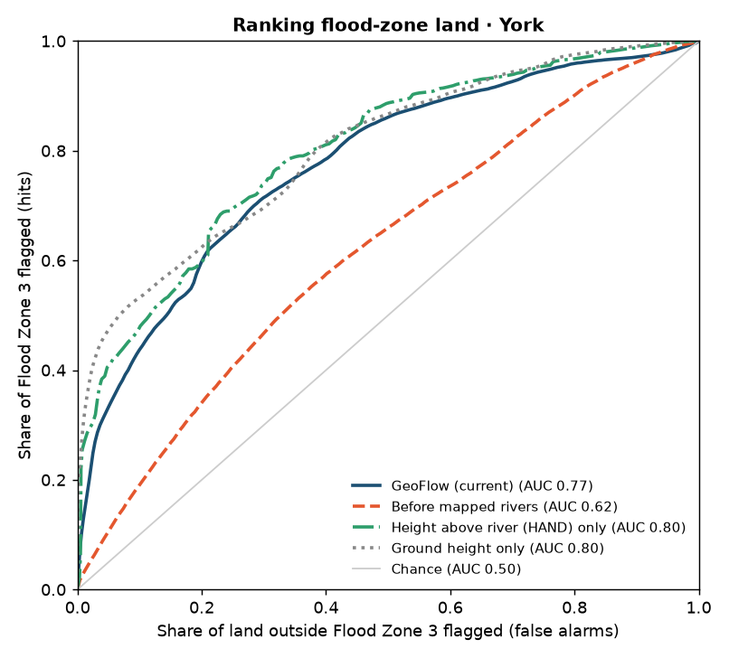
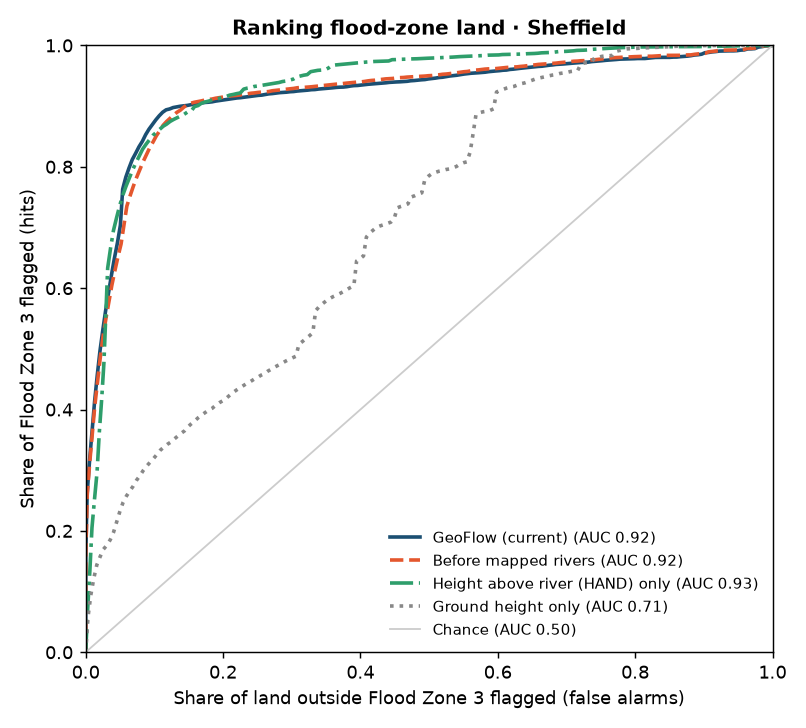

# Validating flood susceptibility against Environment Agency Flood Zones

How accurate is GeoFlow's **Flood risk** workflow? This compares it with the Environment Agency's
[Flood Map for Planning](https://environment.data.gov.uk/dataset/04532375-a198-476e-985e-0579a0a11b47),
the official flood zones for England, at two contrasting sites:

- **York:** flat lowland (about 23 m of relief), where the River Ouse rises far outside the area.
- **Sheffield:** hilly (about 400 m of relief), with steep valleys along the Don, Sheaf, Rivelin and Loxley.

## Method

[`geoflow-backend/validation/ea_flood_zones.py`](geoflow-backend/validation/ea_flood_zones.py) runs the app's
own node handlers, wired exactly like the Flood risk template. It downloads EA Flood Zones 2 and 3 (rivers and
sea) through the EA's OGC API, burns them onto the same 30 m grid, and measures agreement inside each place's
outline.

- **Flood Zone 3:** land with a 1% or greater annual chance of river flooding (0.5% from the sea).
- **Flood Zone 2:** land with a 0.1% to 1% annual chance.
- **ROC AUC:** the main score. It measures how well the susceptibility score ranks flood-zone land above dry
  land, whatever the class breaks are. 0.5 is chance; 1.0 is perfect.

Three comparisons put the score in context:

| Method | What it is |
|---|---|
| GeoFlow (current) | The Flood risk template as shipped |
| Before mapped rivers | The same workflow before rivers from OpenStreetMap were added to the HAND step |
| HAND only | The height-above-river factor on its own, without slope or water history |
| Ground height only | A naive baseline: the lower the ground, the higher the risk |

To reproduce (from `geoflow-backend/`):

```bash
.venv/Scripts/python.exe -m validation.ea_flood_zones --place York --match "York and North Yorkshire"
.venv/Scripts/python.exe -m validation.ea_flood_zones --place Sheffield --match "South Yorkshire"
```

## Results

**ROC AUC against Flood Zone 3:**

| Method | York (flat) | Sheffield (hilly) |
|---|---|---|
| **GeoFlow (current)** | **0.77** | **0.92** |
| Before mapped rivers | 0.62 | 0.92 |
| HAND only | 0.80 | 0.93 |
| Ground height only | 0.80 | 0.71 |

**How the classes line up with Flood Zone 3:**

| | York | Sheffield |
|---|---|---|
| Flood Zone 3, share of the area | 9.1% | 3.0% |
| GeoFlow **High**, share of the area | 5.7% | 2.3% |
| Share of High that is in Flood Zone 3 | 47% (5× the background rate) | 52% (17× the background rate) |
| Share of High that is in Flood Zone 2 or 3 | 54% | 75% |
| Share of Flood Zone 3 classed Moderate or High | 84% | 82% |
| GeoFlow **Moderate**, share of the area | 44% | 7% |

| York | Sheffield |
|---|---|
|  |  |
|  |  |

## What this shows

1. **Strong agreement in hilly terrain.** In Sheffield, GeoFlow ranks flood-zone land with an AUC of 0.92. Three
   quarters of its High class lies in Flood Zones 2 or 3, which together cover just 5.5% of the city.
2. **Adding mapped rivers fixed York.** York's AUC rose from 0.62 to 0.77, with no loss in Sheffield. Without
   mapped rivers, the River Ouse goes undetected and 44% of York is classed High, of which only 12% is in
   Flood Zone 3.
3. **HAND beats the naive baseline where it matters.** Ground height alone does well in York, because York's
   floodplain is the bottom of one flat basin. It fails in Sheffield (0.71), where valley floors sit at very
   different heights. HAND works in both places.
4. **Slope and water history add little.** HAND on its own scores slightly higher than the full weighted
   overlay at both sites (0.80 vs 0.77, 0.93 vs 0.92). Giving HAND more weight is worth testing, ideally on
   more sites so the weights aren't tuned to these two.
5. **The Moderate class is too broad in flat land.** In York it covers 44% of the area, much of it farmland
   outside any flood zone (yellow on the map). Class breaks that adapt to local relief would help.

## Limitations

- **Flood Zones are not ground truth.** They come from hydraulic modelling, are drawn ignoring flood defences,
  and represent specific return periods. GeoFlow's terrain-based score measures something related but
  different.
- **Resolution.** The Copernicus 30 m DEM is a surface model that includes buildings and trees, so narrow
  channels, embankments and urban detail are lost. Many of the missed areas (red on the maps) are small
  watercourses and walled-off washlands.
- **Scope.** The Flood Zones cover river and sea flooding only, not surface water. The results come from two
  sites in England, so they are indicative rather than general.

Flood Zones data © Environment Agency, published under the Open Government Licence. Check the
[dataset page](https://environment.data.gov.uk/dataset/04532375-a198-476e-985e-0579a0a11b47) for current terms.
